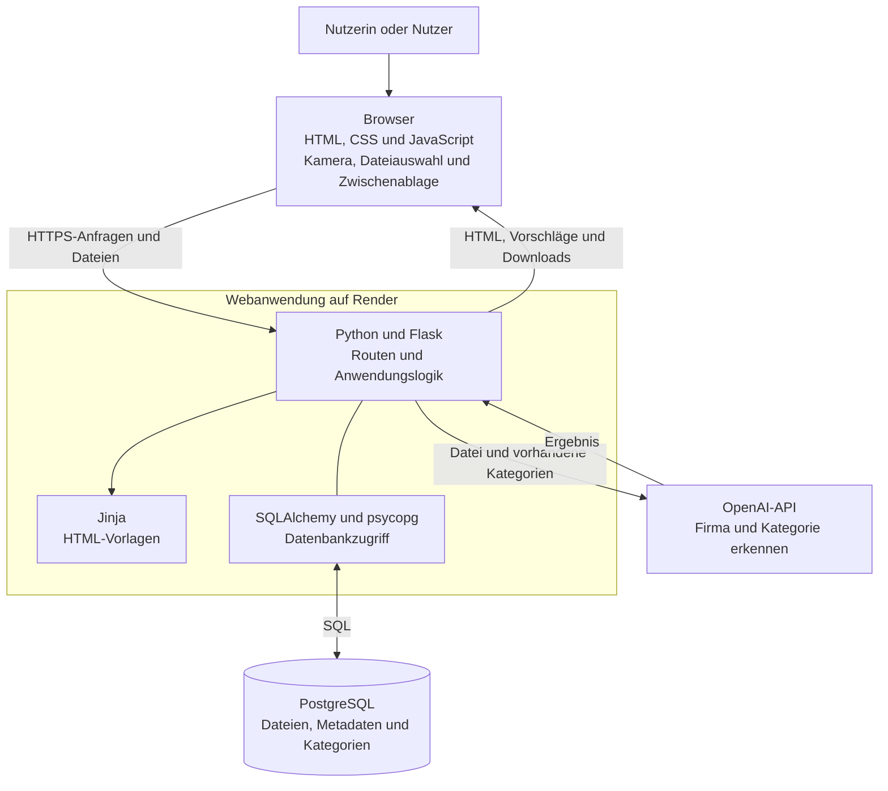
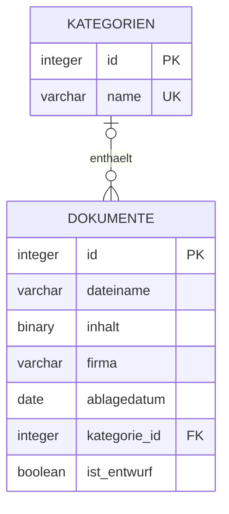

# Applikationsarchitektur

MeinArchiv ist eine Webanwendung mit einem Python-Backend. Flask liefert die Benutzeroberfläche und verarbeitet die Anfragen. PostgreSQL speichert Dateien, Metadaten und Kategorien. OpenAI unterstützt die automatische Dokumentbenennung.

## Komponenten

### Browser

HTML und CSS stellen die Oberfläche dar. JavaScript steuert Kamera, Einfügen aus der Zwischenablage, Vorschau und Bildbearbeitung. Mehrere Scanaufnahmen fasst der Browser zu einem PDF zusammen. PDF.js stellt gespeicherte PDFs mit Seitennavigation dar.

### Flask und Jinja

Flask verarbeitet Dateiübertragung, Validierung, Dokumentverwaltung und Export. Jinja erzeugt HTML aus Vorlagen und Daten. Der gemeinsame Importablauf bereitet einen Entwurf vor, ermittelt den Namen und übernimmt das Dokument erst bei der Speicheraktion ins Archiv.

### Datenbankzugriff

Flask-SQLAlchemy beschreibt die Datenmodelle und Abfragen. psycopg übernimmt die PostgreSQL-Verbindung. Flask-Migrate und Alembic führen Änderungen am Datenbankschema über Migrationen aus.

### OpenAI

Das Backend übermittelt das Dokument zur Erkennung und gibt die vorhandenen Kategorien als Auswahl vor. Der aktuelle Projektcode verwendet das Modell `gpt-5.4-mini`. Flask erzeugt den Dateinamen aus Ablagedatum, erkanntem Dokumenttyp und Firma. Bei Scans basiert die Erkennung auf der ersten Aufnahme. Die Person kann den Namen vor dem Speichern ändern.

## Datenmodell

Ein Dokument besitzt höchstens eine Kategorie. Eine Kategorie kann mehrere Dokumente enthalten. `kategorie_id` ist optional. Dokumente ohne Zuordnung erscheinen im Ordner «Ohne Kategorie».

`inhalt` enthält die Dateidaten. `ist_entwurf` unterscheidet einen vorbereiteten Import von einem endgültig abgelegten Dokument. Beim Löschen einer Kategorie setzt die Fremdschlüsselregel die Zuordnung auf leer. Die Dokumente bleiben im Archiv erhalten.

Die Ordner in der Oberfläche entsprechen den Kategorien. Beim Verschieben ändert sich die Datenbankzuordnung. Der Download liefert den gespeicherten Dateiinhalt.

## Technologieentscheidungen

| Technologie | Begründung für das Semesterprojekt |
| --- | --- |
| HTML, CSS und JavaScript | Die benötigten Interaktionen lassen sich direkt im Browser umsetzen. Kamera und Zwischenablage stehen über Browser-APIs zur Verfügung. |
| Python und Flask | Der Aufbau mit Routen und Fachmodulen bleibt für die Entwicklung und Erklärung des Projekts überschaubar. |
| Jinja | Serverseitige Vorlagen verbinden die vorhandene Flask-Anwendung mit Dokument- und Kategoriedaten. |
| PostgreSQL | Die relationale Struktur passt zu Dokumenten und Kategorien. Transaktionen unterstützen konsistente Änderungen. |
| SQLAlchemy | Python-Modelle bündeln die Datenstrukturen und erleichtern Abfragen und Änderungen. |
| Flask-Migrate und Alembic | Versionierte Migrationen machen Änderungen am Schema nachvollziehbar und auf weitere Umgebungen übertragbar. |
| OpenAI-API | Ein vorhandener Dienst übernimmt die Erkennung von Firma und Dokumenttyp. |
| PDF.js | Eine einheitliche Vorschau ermöglicht das Blättern durch mehrseitige PDFs im Browser. |
| Docker Compose | Eine definierte PostgreSQL-Umgebung erleichtert die lokale Entwicklung und Integrationstests. |
| Render | Die Webanwendung steht für Nutzung und Präsentation über eine öffentliche URL bereit. |
| pytest und GitHub Actions | Tests lassen sich lokal und bei Änderungen auf GitHub mit derselben Projektumgebung ausführen. |

## Entwicklungs- und Betriebsumgebung

Lokal läuft Flask auf dem Entwicklungsrechner. Docker Compose startet PostgreSQL auf Port 5432. Die Integrationstests verwenden einen separaten Datenbankcontainer auf Port 5433.

Render stellt die Online-Anwendung bereit. Die Verbindung zur Datenbank bestimmt `DATABASE_URL`. Zugangsdaten und API-Schlüssel kommen aus der Umgebung. Das Hauptverzeichnis enthält die Projektkonfiguration, `src/app` die Implementierung, `tests` die Tests und `migrations` die Schemaänderungen.

## Geplanter Ausbau

Die folgenden Funktionen sind für spätere Schritte vorgesehen.

- Auswahl des Speicherorts in den Einstellungen.
- Auswahl des KI-Modells oder Anbieters in den Einstellungen.
- Konfigurierbare Regeln für Dokumentnamen.
- Benutzerkonten mit Login und persönlichen Archiven.

Die Architektur muss dafür insbesondere die Speicheranbindung, die KI-Anbindung und die Zuordnung von Dokumenten zu Benutzerkonten erweitern.
