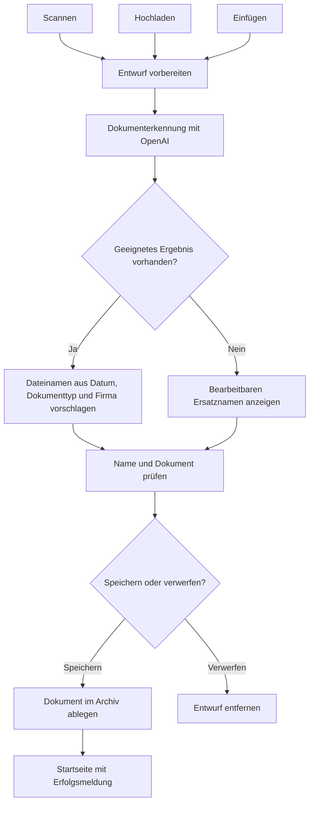

# Use Cases

MeinArchiv unterstützt Personen beim Erfassen und Verwalten ihrer Unterlagen. Die Nutzerin oder der Nutzer ist der Hauptakteur. OpenAI wirkt als externer Dienst bei der automatischen Erkennung mit.

## UC-01 Dokument scannen und ablegen

**Ziel** ist ein abgelegtes PDF aus einer oder mehreren Kameraaufnahmen.

**Voraussetzung** ist eine verfügbare Kamera mit Browserberechtigung. Für die Kamera braucht die Seite HTTPS oder einen lokalen Zugriff über localhost.

**Hauptablauf**

1. Die Person öffnet auf der Startseite «Scannen».
2. Die Kamera öffnet sich. Die Person fotografiert die erste Seite.
3. Die Anwendung bereitet einen Entwurf vor und ermittelt anhand der ersten Aufnahme den Namensvorschlag.
4. Die Person prüft die Seite, schneidet sie bei Bedarf zu oder dreht sie.
5. Über «Seite hinzufügen» nimmt sie weitere Seiten auf. Mit den Pfeilen kann sie die Seiten prüfen und einzeln bearbeiten oder entfernen.
6. Die Person prüft den vorgeschlagenen Namen und wählt «In meine Dokumente speichern».
7. Die Anwendung speichert alle verbleibenden Seiten als ein PDF. Auf der Startseite erscheint die grüne Erfolgsmeldung.

**Alternativen**

- Bei verweigertem Kamerazugriff zeigt die App eine Meldung.
- Beim Abbrechen einer weiteren Aufnahme bleiben die bisherigen Seiten erhalten.
- Ein Entwurf lässt sich über «Entwurf verwerfen» entfernen.
- Bei fehlendem KI-Ergebnis kann die Person den Ersatznamen ändern.
- Überschreitet das PDF die Uploadgrenze, fordert die App zum Verkleinern oder Entfernen einer Seite auf.

**Ergebnis** ist ein abgelegtes PDF mit Dokumentname und zugehörigen Metadaten.

## UC-02 Datei hochladen und ablegen

**Voraussetzung** ist eine vorhandene PDF-, JPG-, JPEG-, PNG-, DOC- oder DOCX-Datei innerhalb der Uploadgrenze.

**Hauptablauf**

1. Die Person öffnet «Hochladen» und wählt eine Datei aus.
2. Die Anwendung übermittelt die Datei an OpenAI und zeigt den vorbereiteten Entwurf mit einem Namensvorschlag auf derselben Seite.
3. Die Person kann den Namen ändern und klickt auf «In meine Dokumente speichern».
4. Die App legt das Dokument ab und öffnet die Startseite mit der Erfolgsmeldung.

**Alternativen** sind eine Fehlermeldung bei leeren, zu grossen oder nicht unterstützten Dateien, die Änderung eines Ersatznamens bei fehlender KI-Erkennung sowie das Verwerfen des Entwurfs.

**Ergebnis** ist die abgelegte Originaldatei mit ihren Metadaten.

## UC-03 Dokument einfügen und ablegen

**Voraussetzung** ist eine kopierte Datei, die der Browser über das Einfügeereignis bereitstellt.

**Hauptablauf**

1. Die Person öffnet «Einfügen», klickt in den Einfügebereich und drückt ⌘ + V beziehungsweise Strg + V.
2. Die App übernimmt die Datei und ermittelt den Namensvorschlag.
3. Die Person prüft den Namen und speichert das Dokument.
4. Die Startseite zeigt die Erfolgsmeldung.

**Alternativen**

- Bei reinem Text oder einer vom Browser nicht bereitgestellten Datei erscheint eine Meldung.
- Die Person kann den Entwurf über «Entwurf löschen» verwerfen.
- Bei fehlender KI-Erkennung lässt sich der angezeigte Name ändern.

**Ergebnis** ist eine abgelegte Datei mit ihren Metadaten.

## UC-04 Dokument suchen

**Voraussetzung** ist ein abgelegtes Dokument.

Die Person gibt einen Teil des Dateinamens in die Suche ein. Die App listet passende Dokumente auf. Die Person öffnet einen Treffer. Bei fehlenden Treffern zeigt die App eine entsprechende Meldung. Alternativ öffnet die Person unter «Meine Dokumente» einen Kategorieordner und wählt dort eine Datei aus.

## UC-05 Dokument ansehen und herunterladen

Die Person öffnet ein Dokument. Die App zeigt Metadaten und bei Bildern oder PDFs eine Vorschau. In der PDF-Vorschau kann sie zwischen den Seiten wechseln. Über «Herunterladen» speichert sie die Datei auf ihrem Gerät. Für Word-Dateien steht der Download zur Verfügung.

## UC-06 Dokument verschieben

Die Person wählt «Verschieben», bestimmt einen vorhandenen Zielordner und bestätigt mit «Hierhin verschieben». Die App aktualisiert die Kategoriezuordnung. Das Dokument erscheint im Zielordner. Die Auswahl «Ohne Kategorie» entfernt die Kategoriezuordnung. Der bestehende Dokumentname bleibt beim Verschieben erhalten.

## UC-07 Dokument umbenennen

Die Person wählt «Umbenennen», gibt einen gültigen Namen ein und bestätigt mit «Namen speichern». Die App aktualisiert den Namen und erhält die Dateiendung. Bei ungültiger Eingabe zeigt sie eine Meldung.

## UC-08 Dokument löschen

1. Die Person wählt bei einem abgelegten Dokument «Löschen», auf der Startseite unter «Zuletzt abgelegt», in einem Ordner oder auf der Detailseite.
2. Die App öffnet die Bestätigungsseite mit dem Dokumentnamen.
3. Die Person klickt auf «Endgültig löschen».
4. Die App entfernt die Datei und ihre Metadaten aus dem Archiv.

Über «Abbrechen» kehrt die Person dorthin zurück, wo sie «Löschen» gewählt hat. Nach dem Löschen gilt dasselbe, ausser beim Start von der Detailseite: Diese existiert danach nicht mehr, deshalb führt die App zu «Meine Dokumente». Das Öffnen der Bestätigungsseite allein entfernt das Dokument noch nicht.

## UC-09 Kategorien verwalten

Die Person öffnet «Kategorien verwalten» und kann eine Kategorie anlegen, umbenennen oder nach Bestätigung löschen. Vergebene Namen weist die App ab. Beim Löschen einer Kategorie bleiben die zugeordneten Dokumente erhalten und erscheinen anschliessend unter «Ohne Kategorie».

## UC-10 Archivstatus einsehen

Die Person öffnet «Einstellungen». Die App zeigt unter anderem die Anzahl abgelegter Dokumente, die Anzahl Kategorien, die gesamte Dateigrösse und ob ein OpenAI-Schlüssel hinterlegt ist.

## UC-11 Dokumente exportieren

Die Person wählt in den Einstellungen «Dokumente als ZIP exportieren». Die App erstellt ein ZIP mit abgelegten Dateien und Metadaten. Offene Entwürfe sind vom Export ausgenommen. Die vorhandenen Archivdaten bleiben erhalten.

## Gemeinsamer Ablauf der Dokumentablage

Bei mehrseitigen Scans basiert der Namensvorschlag auf der ersten Aufnahme. Die endgültige Datei enthält die ausgewählten Seiten. Die Person bestätigt die endgültige Ablage mit dem Speicherbutton.
